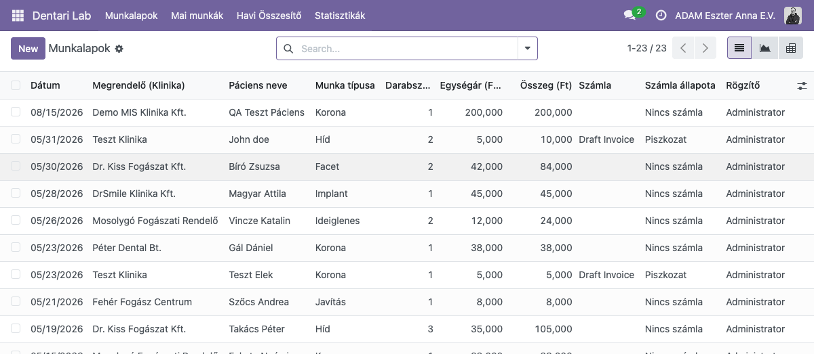
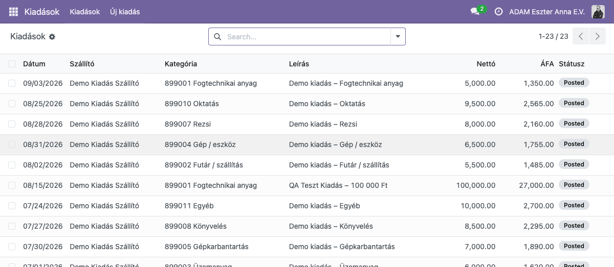
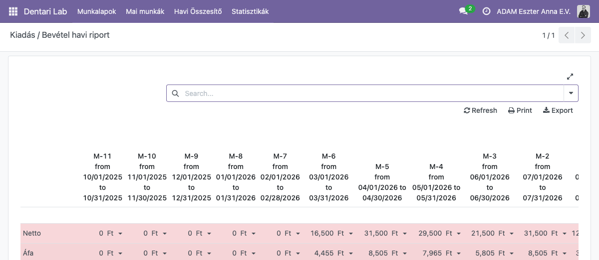

# DentariOdoo

> **Custom Odoo 18 module suite for dental laboratory operations.**  
> Invoice-ready, multi-clinic, audit-logged — self-hosted via Docker Compose.

---

## Overview

DentariOdoo is a custom **Odoo 18** module suite for a dental laboratory. Four installable addons:

| Module | Purpose |
|--------|---------|
| `dentari_lab` | Work sheet tracking (`dental.work.log`), monthly invoicing wizard, monthly email digest |
| `dental_quick_expense` | Lightweight expense-recording wizard over Vendor Bills, 11 expense categories |
| `dentari_mis_reports` | Rolling 12-month Kiadás/Bevétel (expense/revenue) profitability report, built on `mis_builder` |
| `dentari_invoice_archive` | Archives szamlazz.hu-issued invoices into Odoo as draft `account.move` records — legal record-keeping now, zero migration later if Odoo-native invoicing goes live |

| Capability | How |
|------------|-----|
| Work sheet management | `dentari_lab` — `dental.work.log` model |
| Role-based access | Lab Technician / Lab Manager security groups |
| Audit trail | `mail.thread` field-level change tracking |
| Invoicing | `account.move` bridge |
| Multi-clinic | Partner-based clinic separation |
| Monthly email digest | `dentari_lab` digest wizard + templates |
| Quick expense entry | `dental_quick_expense` wizard → draft Vendor Bill |
| Kiadás/Bevétel reporting | `dentari_mis_reports` — rolling 12-month `mis.report.instance`, colorized report rows, per-column date ranges, "Statisztikák" menu |
| Dev-only QA dashboard | Round-number demo data + smoke test for report verification |
| Invoice archive (szamlazz.hu) | `dentari_invoice_archive` — daily cron pulls issued invoices via the szamlazz.hu Agent API into draft `account.move`, "Számla archívum" menu |

**Current status:** `dentari_lab`, `dental_quick_expense`, and `dentari_mis_reports` installable and deployed. `dentari_invoice_archive` is built and merged to `develop`, not yet installed on any environment — needs the `dentari_invoice_archive.szamlazz_agent_key` system parameter set before its cron is enabled (see module's own spec doc).

**Screenshots** (dev environment, demo data):

| `dentari_lab` — Munkalapok | `dental_quick_expense` — Kiadások | `dentari_mis_reports` — Kiadás/Bevétel |
|:---:|:---:|:---:|
|  |  |  |

---

## Docs

| Document | Purpose |
|----------|---------|
| [docs/PROJECT-ANALYSIS.md](docs/PROJECT-ANALYSIS.md) | Project analysis notes |
| [docs/dental_quick_expense-spike-findings.md](docs/dental_quick_expense-spike-findings.md) | Dental Quick Expense Phase 0 spike findings |
| [docs/invoice-archive-spike-findings.md](docs/invoice-archive-spike-findings.md) | Invoice Archive — szamlazz.hu Agent API Phase 0 spike findings |
| [docs/superpowers/specs/2026-06-12-monthly-email-design.md](docs/superpowers/specs/2026-06-12-monthly-email-design.md) | Monthly email digest — design spec |
| [docs/superpowers/plans/2026-06-12-monthly-email.md](docs/superpowers/plans/2026-06-12-monthly-email.md) | Monthly email digest — implementation plan |
| [docs/superpowers/specs/2026-09-02-dental-quick-expense-design.md](docs/superpowers/specs/2026-09-02-dental-quick-expense-design.md) | Dental Quick Expense — design spec |
| [docs/superpowers/plans/2026-09-02-dental-quick-expense.md](docs/superpowers/plans/2026-09-02-dental-quick-expense.md) | Dental Quick Expense — implementation plan |
| [docs/superpowers/specs/2026-09-03-mis-builder-reports-design.md](docs/superpowers/specs/2026-09-03-mis-builder-reports-design.md) | MIS builder (Kiadás/Bevétel) reports — design spec |
| [docs/superpowers/plans/2026-09-03-mis-builder-reports.md](docs/superpowers/plans/2026-09-03-mis-builder-reports.md) | MIS builder (Kiadás/Bevétel) reports — implementation plan |
| [docs/superpowers/specs/2026-10-10-invoice-archive-design.md](docs/superpowers/specs/2026-10-10-invoice-archive-design.md) | Invoice Archive (szamlazz.hu) — design spec |
| [docs/superpowers/plans/2026-10-10-invoice-archive.md](docs/superpowers/plans/2026-10-10-invoice-archive.md) | Invoice Archive (szamlazz.hu) — implementation plan |

*(`docs/DESIGN.md`, `DEPLOY.md`, `TESTING.md` were removed — no longer part of this repo.)*

---

## Installing a module

Nothing fancy:

1. Point Odoo's `addons_path` at this repo root — each top-level folder (`dentari_lab`, `dental_quick_expense`, `dentari_mis_reports`, `dentari_invoice_archive`) is one addon.
2. `pip install -r requirements.txt` first. It pins things specific modules need — `pyOpenSSL` (oec.sh's Odoo 18 base image needs it explicitly, see the file's comments) and `odoo-addon-mis-builder` (`dentari_mis_reports`' dependency, from OCA's reporting-engine). Skipping this breaks install/deploy, not just that one module.
3. In Odoo: **Apps → Update Apps List**, then search the module name and **Install**.
4. Check the module's own spec doc (table above) for anything it needs configured after install — e.g. `dentari_invoice_archive` needs its szamlazz.hu agent key set as a system parameter before its cron can sync anything.

---

## Development

This project ships via **oec.sh**. Deploys are manual — pushing to `main`/`develop`
does **not** auto-deploy; trigger a deploy explicitly, then run the module
upgrade/install for whatever changed. Use the `oecsh` MCP server's tools for this
(project/environment listing, deploy, task status, logs) — it replaced the old
`odoo-oecsh-ticket-deploy` skill.
